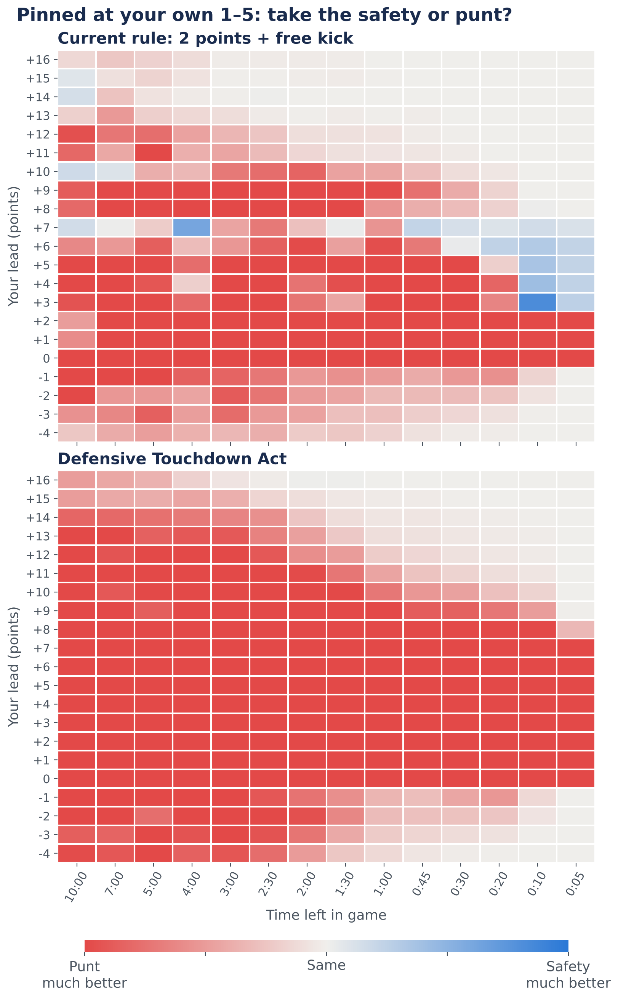
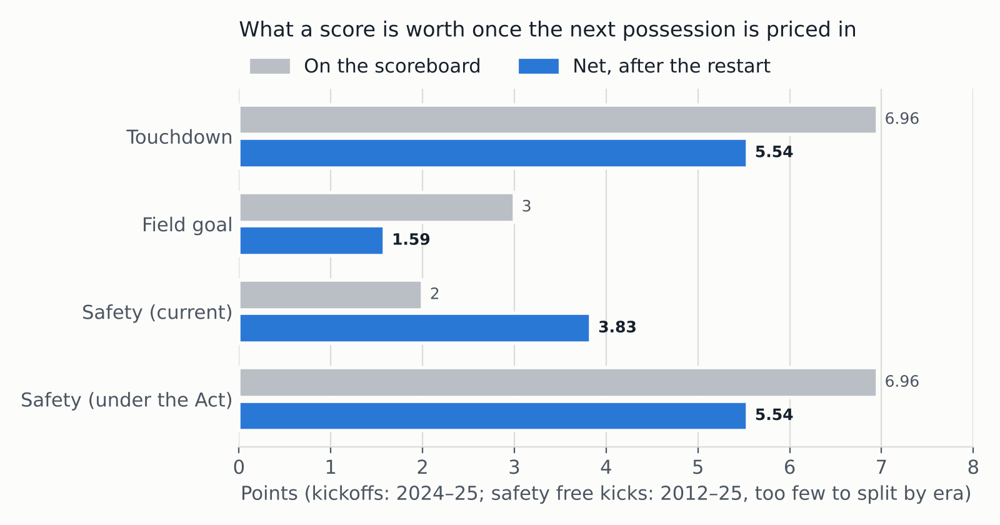

# Handoff: Prose Edit for "The Defensive Touchdown Act"

**For:** Gemini (prose editor)
**From:** Chief of Staff, Ministry of Silly Plots
**Date:** 2026-11-10
**Deliverable:** one complete, edited copy of the post below, plus a short change log

---

## 1. What this is

The Ministry of Silly Plots (sillyplots.com) publishes serious data analysis of ridiculous subjects. The joke is the solemnity. The analysis underneath is always real.

This post proposes an NFL rule change: score a safety as a **touchdown for the defense**, followed by a normal kickoff, with a clock reset in the final two minutes. It is built on 675,997 NFL plays (2012–2025). The analysis is finished, red-teamed and verified. **Your job is the prose only.**

Audience: football fans who like numbers. They know what a safety, punt and kickoff are. They don't know what "expected points" or "win probability" are in technical terms.

## 2. What we want from you

- **Tighten.** Cut repetition and throat-clearing. The post is long and some points appear twice (for example, the pick-six swing comparison and the goal-line stakes). Say each thing once, in the best place.
- **Sharpen the deadpan.** Tone is dry bureaucratic comedy: Monty Python, the film *Brazil*, a government white paper written with a straight face. The humor comes from treating a silly premise with full official solemnity, not from jokes or wordplay. Clarity always beats a bit; if a joke makes a sentence harder to understand, cut the joke.
- **Make the jargon land for a general reader.** "Net value", "swing", "expected points" and "WP pts" should be clear on first use without slowing the reader down.
- **Improve flow** between sections, especially from the at-a-glance table into "The Case for the Act".
- Short, direct sentences. Active voice.

## 3. Hard rules (do not break these)

1. **Do not change any number, sample size, date, team, or game.** Every figure comes from the analysis and has been checked. If a number reads awkwardly, rephrase around it. If you think a number is wrong, flag it in your change log; do not "fix" it.
2. **Do not add facts, claims, history, quotes, citations, or rule-book references** that are not already in the post. No new examples. No player names beyond what is there.
3. **Keep the honesty paragraph** ("What the data does and does not say"). It says the data shows the safety is undervalued but does **not** show a safety must equal a touchdown, which is the Act's principle. You may reword it; you may not soften, remove, or bury it.
4. **Keep the caveats:** the results figure is an upper bound; offenses would adapt and this is not modeled; the pale-blue cells are model noise; the small 2024–25 free-kick sample.
5. **Keep all markup working.** The file is Jekyll/kramdown Markdown with embedded HTML:
   - Keep the front matter (`---` block), the `<style>` block, and `<div class="dta" markdown="1">` … `</div>` exactly as they are.
   - Keep HTML tags and their classes (`brief`, `label`, `doc`, `section`, `note`, `filing`, `signoff`, `figure`, `figcaption`). Edit the text inside them freely.
   - Keep Markdown tables as tables with the same columns. Keep the `{: .costs}` line directly under the cost table.
   - Keep image paths unchanged.
6. **Keep the structure:** In brief → Proposed Amendment → At a Glance → Case for the Act (3 arguments) → What the Act Would Cost → Objections → Methods → Recommendation. You may retitle headings.
7. **The amendment text (Sections 1–5) is legal wording.** You may polish the preamble's WHEREAS clauses. Change Sections 1–4 only for clarity, never for meaning. Section 5 is a joke; keep it.
8. **Methods and Data** is a reference list. Light edits only.
9. Don't use em-dashes as asides, "not X, but Y" constructions, or stock phrases ("it's worth noting", "in conclusion", "delve").

## 4. Facts you may want to rephrase around (do not alter)

- Safety today: 2 points on the scoreboard, worth **3.83** net (free kick to the scorer worth +1.83). Under the Act: **5.54** net, same as any touchdown.
- Field goal net **1.59**; touchdown net **5.54**; a safety ≈ **2.4 field goals**.
- Swing from before the snap: safety today **2.9**, under the Act **4.6**, pick-six **6.7**.
- Punting beats conceding from own 1–2 by **0.83** points today, **2.54** under the Act.
- Intentional safety window today: leading by **3–7**, final **10–45 seconds**. Under the Act: no state where conceding helps (max **0.1–0.2** WP pts, noise).
- **11** intentional end-of-game safeties since 2012; only **2** started inside the own 5; retreats from as far as the own **34**; Super Bowl XLVII example.
- **220** earned safeties: sack 86, stopped runner 66, grounding 22, other penalties 22, blocked punt 14, other 10. **77%** on drives starting inside own 10; **31%** on a drive's first snap; **6%** beyond own 20.
- Cost: ~**27** points/season league-wide; **20–30** results reversed (22 flips + 8 overtimes with an extra point); goal-line stakes **1.0–3.3 → 2.8–5.0**.
- Buffalo at Miami, 2022 Week 3: a Miami punt deflected off an offensive player out of the end zone; Buffalo lost 21–19.

## 5. What to send back

1. The **complete edited file**, from the opening `---` to the closing `</div>`, in one code block, ready to paste over the original.
2. A **change log** of 5–15 bullets: what you changed and why, and anything you flagged but did not change (for example, a number that looked inconsistent).

Do not return partial sections or a diff.

---

## 6. The current post (`posts/safety/index.md`)

````markdown
---
layout: default
title: "The Defensive Touchdown Act: A Data-Driven Proposal to Revalue the Safety"
permalink: /post/safety/
---

<style>
  .dta { max-width: 760px; margin: 0 auto; padding-bottom: 3rem; }
  .dta h1 { font-size: clamp(2rem, 6vw, 2.9rem); text-wrap: balance; margin-bottom: .4rem; }
  .dta h2 { font-size: 1.7rem; margin-top: 3rem; padding-top: 1.25rem; border-top: 2px solid var(--color-primary); }
  .dta h3 { font-size: 1.25rem; margin-top: 2rem; }
  .dta p, .dta li { font-size: 1.08rem; }
  .dta .filing { font-size: .82rem; letter-spacing: .08em; text-transform: uppercase; color: #6b6b66; margin-bottom: 1.75rem; }
  .dta .brief { background: #fff; border: 1px solid var(--color-border); border-top: 5px solid var(--color-accent); padding: 1.25rem 1.4rem .5rem; margin: 0 0 2rem; }
  .dta .brief .label, .dta .doc .label { display: block; font-size: .78rem; font-weight: 600; letter-spacing: .12em; text-transform: uppercase; color: var(--color-secondary); margin-bottom: .5rem; }
  .dta .brief ul { padding-left: 1.2rem; }
  .dta .brief li { margin-bottom: .6rem; }
  .dta .doc { background: #fff; border: 4px double var(--color-primary); padding: 1.4rem 1.5rem .6rem; margin: 1.25rem 0 1.5rem; }
  .dta .doc p { font-size: 1.02rem; }
  .dta .doc .section { padding-left: .9rem; border-left: 3px solid var(--color-accent); }
  .dta table { width: 100%; border-collapse: collapse; margin: 1.25rem 0 .4rem; font-size: .98rem; background: #fff; font-variant-numeric: tabular-nums; }
  .dta th { background: var(--color-primary); color: #fff; font-weight: 600; text-align: left; padding: .55rem .75rem; line-height: 1.3; }
  .dta td { padding: .55rem .75rem; border-bottom: 1px solid var(--color-border); vertical-align: top; line-height: 1.4; }
  .dta tbody tr:nth-child(even) td { background: #f9f9f6; }
  .dta td:not(:first-child), .dta th:not(:first-child) { text-align: right; }
  .dta td strong { color: var(--color-primary); }
  .dta table.costs td, .dta table.costs th { text-align: left; }
  .dta table.costs td:first-child { white-space: nowrap; }
  .dta .note { font-size: .88rem; color: #6b6b66; line-height: 1.5; margin: .35rem 0 1.5rem; }
  .dta figure { margin: 1.75rem 0; background: #fff; border: 1px solid var(--color-border); padding: .75rem; }
  .dta figure img { display: block; width: 100%; }
  .dta figcaption { font-size: .88rem; color: #6b6b66; line-height: 1.5; padding: .6rem .25rem 0; }
  .dta .signoff { margin-top: 2.5rem; font-style: italic; }
  @media (max-width: 600px) {
    .dta p, .dta li { font-size: 1rem; }
    .dta table { font-size: .86rem; }
    .dta th, .dta td { padding: .45rem .5rem; }
    .dta .doc, .dta .brief { padding: 1rem 1rem .4rem; }
  }
</style>

<div class="dta" markdown="1">

# The Defensive Touchdown Act

<p class="filing">A data-driven proposal to revalue the safety · Ministry of Silly Plots, Office of Scoring Reform · File 2-PT/SAF · November 9, 2026</p>

<div class="brief">
<span class="label">In brief</span>
<p>The Ministry proposes that a safety be scored as a <strong>touchdown for the defense</strong>, followed by a normal kickoff. A defense that drives an offense backward into its own end zone has done something worth a touchdown, and should be paid like it. Using 675,997 NFL plays from 2012 to 2025, we find the Act would:</p>
<ul>
<li><strong>Reward defenses that earn safeties.</strong> Four in five come from the pass rush or run defense.</li>
<li><strong>Correct a scoreboard that already undervalues the safety.</strong> Counting the free kick, it is worth about 3.8 points, not 2.</li>
<li><strong>End the backward run.</strong> The only deliberate use of a safety today is a punter retreating to burn the clock.</li>
</ul>
<p>The cost: about 27 points a season across the league, and 20 to 30 results since 2012 that would have gone the other way.</p>
</div>

## The Proposed Amendment

<div class="doc">
<span class="label">Preamble</span>
<p><strong>WHEREAS</strong> a field goal is worth three points and a safety two, although a field goal requires the offense to advance and a safety requires the defense to send it backward through its own end zone;</p>
<p><strong>WHEREAS</strong> the two points have not been revised in living memory, and no member of this Ministry can recall being consulted;</p>
<p><strong>WHEREAS</strong> the rules currently reward a team protecting a late lead for having its punter run as far as 34 yards backward and be tackled in his own end zone;</p>
<p><strong>NOW, THEREFORE,</strong> the Ministry proposes:</p>
<span class="label">Text of the Act</span>
<p class="section"><strong>Section 1.</strong> A safety shall be scored as a touchdown for the defending team, worth six points.</p>
<p class="section"><strong>Section 2.</strong> The scoring team shall be entitled to a try, as after any touchdown.</p>
<p class="section"><strong>Section 3.</strong> Following the try, the scoring team shall kick off to the team that conceded the safety, under the kickoff rules then in force. The free kick from the 20-yard line is abolished.</p>
<p class="section"><strong>Section 4.</strong> If a safety occurs in the final two minutes of either half, the game clock shall be reset to the time remaining at the snap.</p>
<p class="section"><strong>Section 5.</strong> Nothing in this amendment shall be construed as an endorsement of punters running backward.</p>
</div>

## The Act at a Glance

| | Current rule | Under the Act |
|---|---:|---:|
| Points on the scoreboard | 2 | 6 + try (6.96 avg.) |
| Who gets the ball next | defense, by free kick | offense, by kickoff |
| Net value to the defense | 3.83 | **5.54** |
| Swing for the defense, vs. before the snap | 2.9 | **4.6** |
| How much better punting is than conceding, own 1–2 | 0.83 pts | **2.54 pts** |
| Largest gain from conceding on purpose | 4.9 WP pts | **0.2 WP pts** |
| Extra value across the league per season | — | **~27 pts** |

<p class="note">Net value = points scored, plus or minus the value of the next possession, in expected points. WP pts = percentage points of win probability. The current-rule column uses all 185 post-safety free kicks from 2012–25; the Act column uses 2024–25 kickoffs.</p>

The chart below shows the Act's main effect. Each cell compares conceding a safety with punting, for a team facing 4th down at its own 1–5 in the fourth quarter. Under the current rule there is a blue corner in the final seconds, where conceding wins. Under the Act there is none.

<figure>

<figcaption>Win-probability model trained on 2012–24 snaps. Each cell resamples real punts from a team's own 1–5 (449 plays), real post-safety free kicks (207) and, for the Act, real kickoffs. Assumes 2 timeouts each, an even point spread, and 5 seconds burned by the punter. Isolated pale-blue cells away from the final seconds, such as +7 at 4:00, are model noise of about ±3 points.</figcaption>
</figure>

## The Case for the Act

### 1. Defenses earn safeties

Of the 220 safeties since 2012 that were not conceded on purpose:

| How it happened | Safeties |
|---|---:|
| Sack | 86 |
| Ball carrier stopped in the end zone | 66 |
| Intentional grounding in the end zone | 22 |
| Offensive penalty in the end zone (mostly holding) | 22 |
| Blocked punt | 14 |
| Other | 10 |

Sacks and stopped runs alone account for about two thirds. Counting intentional grounding, usually a quarterback under pressure, the pass rush and run defense account for four in five.

The field position usually comes first. 77% of these safeties came on drives that started inside the offense's own 10, and 31% on the drive's very first snap. Only 6% came on drives that began beyond the offense's own 20. The defense usually finishes a job that a punter or kickoff coverage unit started. The Act pays the defense for the finish. The Ministry regards the rest as teamwork and declines to split the award.

### 2. The scoreboard already undervalues the safety

Every score has two parts: the points, and what happens next. After a touchdown or field goal, the scoring team kicks off. After a safety, the conceding team must free-kick from its own 20, and the *scoring* team gets the ball. We priced that next possession after every restart since 2012.

<figure>

<figcaption>Net value = scoreboard points plus or minus the expected points of the next possession, measured at its first snap. Kickoffs: 2024–25 (2,476 after touchdowns, 1,683 after field goals). Free kicks after a safety: all 185 from 2012–25 (standard error 0.06); the 21 in 2024–25 alone give 1.93 ± 0.43.</figcaption>
</figure>

A safety is already worth about 2.4 field goals once each is netted against the possession that follows. In 2024–25, receiving a free kick was worth 0.51 points more than receiving a kickoff (95% interval 0.11 to 0.95). The field goal, meanwhile, keeps getting cheaper. Receivers now start after a field goal at their own 30 on average, up from their own 22 in 2012–15, and a field goal's net value has fallen from 2.25 to 1.59.

**What the data does and does not say.** It says the scoreboard undervalues the safety by about two points. It does not say a safety must equal a touchdown: that is the Act's principle, not its evidence. Under the Act the defense's net value matches any touchdown's. Its swing, measured from where the defense stood before the snap, does not: 4.6 points, against 6.7 for a pick-six, because a pick-six usually takes the ball from an offense in better shape.

### 3. It ends the backward run

Under the current rule, conceding a safety from deep is worse than punting in expected points: by 0.83 points from the 1–2, 1.17 from the 3–5, and 1.42 from the 6–10. In win probability, conceding wins only when leading by 3 to 7 points in the final 10 to 45 seconds.

That window is clock arithmetic. A deep punt takes a median of 11 seconds to reach the next snap, and a safety plus free kick takes 12. The more time the punter burns before giving himself up, the more conceding pays:

| Seconds the punter burns | Leads where conceding helps (final 30 s) | Largest gain |
|---|---:|---:|
| 0 | +5 to +7 | 1.7 WP pts |
| 5 (as charted) | +3 to +7 | 4.9 WP pts |
| 10 | +3 to +7 | 11.6 WP pts |

The league uses the play exactly this way. Since 2012 there have been 11 intentional end-of-game safeties, all by teams leading by 5 to 30 with 63 seconds or less left. Only 2 of the 11 snapped from inside their own 5; the rest retreated from as far out as their own 34. The best known is Baltimore's in Super Bowl XLVII: up 5 with 12 seconds left, the punter ran 8 seconds off the clock before stepping out of the end zone.

Under Sections 1–3 of the Act, conceding costs about 7 points instead of 2. No state on the grid rewards it: the largest gain anywhere is 0.1 WP pts, which is noise. A few states remain where conceding is merely free, at leads of 9 or more in the final seconds, when a punt also wins. Section 4 removes the clock time the retreat was buying. With it, those states cost 0.01 to 3.7 WP pts, and the backward run has no purpose left.

## What the Act Would Cost

| Cost | Detail |
|---|---|
| **Points** | +1.71 net per earned safety; at 15.7 a season, about 27 points across all 32 teams |
| **Results** | 20 to 30 reversed since 2012, depending on the try; with an extra point, 22 flips and 8 overtimes |
| **The goal line** | An offense stopped at its own 1 instead of in its end zone: worth 1.0–3.3 points to the defense today, 2.8–5.0 under the Act |
| **Penalties** | Intentional grounding (22) and other offensive penalties (22) in the end zone become 7-point calls, as do 14 blocked punts out of the end zone |
{: .costs}

<p class="note">The results figure applies the Act to final scores only. It is an upper bound: teams would have played those games differently, and the defense would have kicked off rather than received. Among the reversals is Buffalo at Miami, 2022 Week 3, when a Miami punt deflected off an offensive player and left the end zone, and Buffalo lost 21–19.</p>

Spot-of-ball and forward-progress calls at an offense's own goal line would carry near-touchdown stakes. The Ministry notes that the opposite goal line has carried such stakes since the invention of the goal line.

## Objections Considered

**"A sack is not a pick-six."** Agreed. In swing terms it would still be worth 4.6 points against 6.7. The Ministry observes that both plays end with the defense in the end zone and the offense in disgrace.

**"Offenses would adapt."** They would. Teams pinned deep would likely punt earlier, call safer plays and hold less near their own goal line. This analysis prices the Act against today's behavior and does not model those responses.

**"The free kick is part of the safety's charm."** The free kick is the reason the safety is undervalued today. The Ministry is unsentimental about it.

**"Expected points are not points."** Net value credits the scorer with the possession that follows. A strict reading of the scoreboard gives no such credit. This Ministry reads the whole game.

**Prior art.** Analysts have long noted that the free kick makes a safety worth more than two points. The Ministry claims no novelty for that observation, only for the paperwork.

## Methods and Data

- **Data:** nflverse play-by-play, 2012–2025 regular and postseason: 675,997 plays in 3,829 games, deduplicated on game and play ID.
- **Restart value:** nflverse expected points at the first snap after each kickoff or free kick, excluding the final two minutes of each half. nflverse's own EPA scores a safety as a flat −2 and leaves out the free kick, so we price the free kick separately.
- **Win probability:** a gradient-boosted classifier, constrained so that more points and better field position never lower win probability. Trained on 2012–24 and tested on 2025, where its Brier score is 0.159 against nflverse's 0.171. In the final 60 seconds (936 snaps) the two are level at 0.082.
- **Act simulation:** end-of-game kickoffs are drawn from 714 real kickoffs by teams trailing by 1–8 in the final five minutes. About half were onside attempts; the kicking team recovered 5.5%.
- **Code:** `posts/safety/analysis/safety_analysis.py`. Every figure in this post is in `results.json` or the two decision-grid CSVs beside it.

## Recommendation

The Ministry recommends that the Defensive Touchdown Act be adopted at the next available competition committee meeting or, failing that, the next available Thanksgiving dinner.

<p class="signoff">Respectfully submitted,<br>The Office of Scoring Reform, Ministry of Silly Plots</p>

</div>

````
