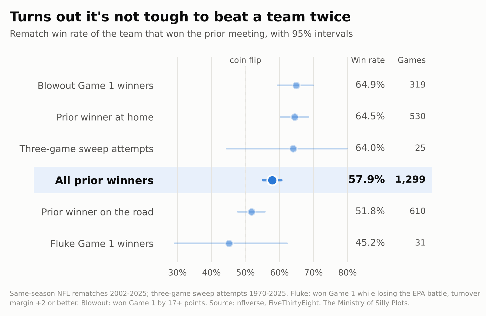

# Is It Really Tough to Beat a Team Twice? An Econometric Autopsy of Broadcast Booth Folklore

> November 8, 2026

  <strong>SUMMARY</strong> 
  Every January, a broadcaster in a quarter-zip informs the nation that it is very hard to beat the same team three times in one season. We examined 1,299 same-season NFL rematch games. Teams that won the prior meeting won the rematch 57.9% of the time. After controlling for team quality and home field, we find no rematch penalty. If anything, prior winners do slightly better than expected. The Ministry has classified the claim as <strong>Grade-A Broadcast Mythology</strong>.

<a href="/posts/rematch/docs/rematch_myth_mosp.pdf" style="display: block; text-align: center; background-color: #007bff; color: white; padding: 12px 24px; text-decoration: none; border-radius: 4px; font-weight: bold; margin: 20px auto; width: fit-content;" target="_blank">Download Full PDF Report</a>

In February, this Ministry determined that Levi's Stadium is the second most Starbucks-dominant venue in the NFL and forecast that a Dunkin'-dependent Patriots offense would struggle there. The Seahawks won. Having settled the matter of coffee, we turned our attention to a claim that is made on national television every week of the playoffs, by professionals, without supporting evidence.

The claim is that **beating a team once makes it harder to beat them again.** It is usually delivered in its premium form: *"You know, Jim, it is almost impossible to beat a team three times in one season."*

Everyone in the booth remembers the 2007 Giants. Nobody remembers the many teams that beat an opponent twice and then simply beat them again, because "the better team won again" does not fill a pregame segment.

Our newest [working paper](/posts/rematch/docs/rematch_myth_mosp.pdf) (pending peer review) puts the claim to a formal test.

## The Raw Record

We assembled 1,299 same-season rematch games: regular-season divisional Game 2s, non-divisional playoff rematches, and the three-game sweep attempts that so preoccupy January television. In each case, we asked one question: did the team that won the last meeting win this one?

  
  
<em>Table 1: Record of the Prior-Game Winner in Rematches</em>

The winner of the first meeting won the rematch **57.9%** of the time, 7.9 points better than a coin flip.

Teams attempting the dreaded three-game sweep went **16-9 (64.0%)**. We note that this is the best record in the table. We also note that it rests on 25 games, and its 95% confidence interval runs from 44.5% to 79.8%, which comfortably includes a coin flip. We report it because the booth insists on discussing it, not because it tells us much.

## Holding Quality Constant

A 57.9% rematch rate does not, by itself, refute the booth. Good teams win the first game, and good teams also win the second. To isolate the effect of *having already beaten this particular opponent*, we must hold team quality constant.

We measure quality with **Leave-One-Opponent-Out EPA**: each team's net expected points added per play, computed from every game except those against the rematch opponent, so that the games being explained do not also explain themselves. We then fit a logistic model of rematch outcomes on the quality gap, home field, and a rematch indicator, γ. If the booth is right, γ is negative.

  
  
<em>The Rematch Penalty Model</em>

  
  
<em>Table 2: The Rematch Penalty, Controlling for LOOO-EPA and Home Field</em>

The estimated rematch penalty is **γ = +0.12 (p = 0.07)**. It has the wrong sign. Prior winners win about 2.8 points more often than their quality and venue predict, with a 95% confidence interval running from 0.2 points worse to 5.8 points better.

The most likely explanation is mundane. Our quality measure deliberately ignores the head-to-head games, so the result of the first meeting probably still carries some information about the matchup. Having beaten a team is, if anything, mild evidence that one can beat them again.

In the interest of scholarly integrity, we note that the interval does not quite exclude zero. It does exclude any penalty larger than a fraction of a point, and it rules out the booth's preferred magnitude, which is "almost impossible."

## The Venue Alternation Problem

Divisional opponents alternate home games. Home teams win more often, so the winner of Game 1 was disproportionately the home team in Game 1, and is therefore disproportionately the road team in Game 2.

In our sample, 53.3% of divisional Game 1 winners played Game 2 on the road. Those who got the rematch at home won 64.5% of the time. Those on the road won 51.8%.

The imbalance is mild: it lowers the overall rematch rate by less than half a point. The effect within each game is not. A prior winner playing the rematch on the road is barely better than a coin flip, and these are the games that supply the booth with its anecdotes. The booth has, in effect, rediscovered home-field advantage and mistaken it for a curse.

## Familiarity

The booth's fallback position is that rematches are at least closer, as the two teams learn each other's tendencies. Across 2,304 divisional games, holding the quality gap fixed, rematch margins were **0.6 points wider** than first meetings (p = 0.10). Familiarity does not visibly compress anything.

## The Turnover Lottery

Not every Game 1 winner was the better team on the day. We separated **fluke winners** (teams that won Game 1 while losing the EPA battle, with a turnover margin of +2 or better) from **blowout winners** (teams that won Game 1 by 17 or more points), and checked how each fared in the rematch.

  
  
<em>Table 3: Rematch Win Rate by Game 1 Profile</em>

Fluke winners went on to lose the rematch more often than not, going **14-17 (45.2%)**. Blowout winners won **64.9%**. The fluke sample is small and its interval is wide, but the gap between the two groups is statistically real (p = 0.03).

It is also fully explained by quality. Fluke winners had essentially no quality edge over their opponents, and once quality is accounted for, being a fluke winner makes no measurable difference to the rematch. Fluke winners lose at exactly the rate their quality predicts. This is not because beating a team twice is hard. It is because the fluke winners were never the better team, and the bounces stopped bouncing. Observing these teams, the booth has mistaken regression to the mean for a law of nature.

  
  
Rematch win rate of the prior-meeting winner, by situation.

Taken together, the picture is consistent. Who wins a rematch depends on who is better and who is at home. Whether they have met before does not enter into it.

## Verdict

Based on 1,299 rematch games and controls for quality and venue, the Ministry of Silly Plots officially classifies *"It's tough to beat a team twice"* as **Grade-A Broadcast Mythology**.

It is tough to beat a *better* team twice. It is tough to beat a team twice *on the road*. It is tough to win a second turnover lottery. It is not especially tough to beat a team twice.

<a href="/posts/rematch/docs/rematch_myth_mosp.pdf" style="display: block; text-align: center; background-color: #007bff; color: white; padding: 12px 24px; text-decoration: none; border-radius: 4px; font-weight: bold; margin: 20px auto; width: fit-content;">Read the Full Technical Paper (PDF)</a>
