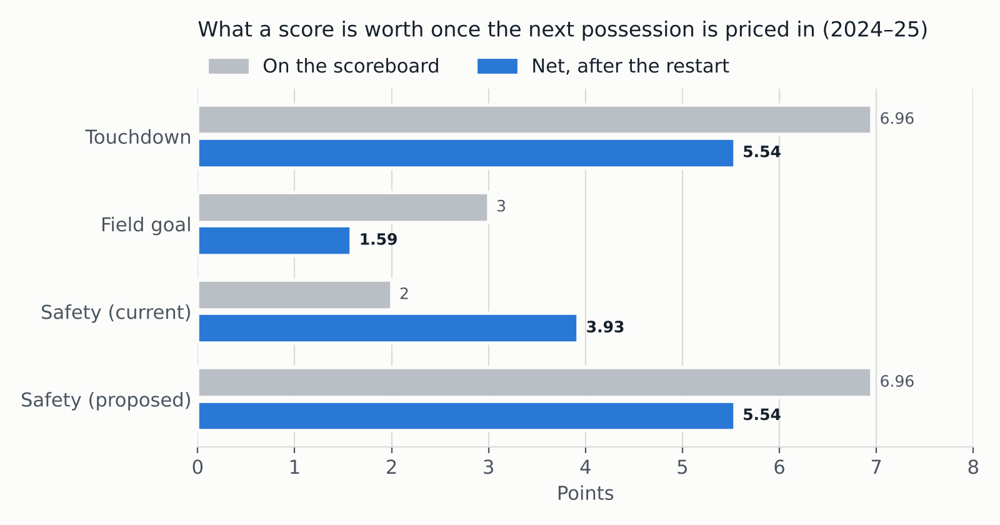
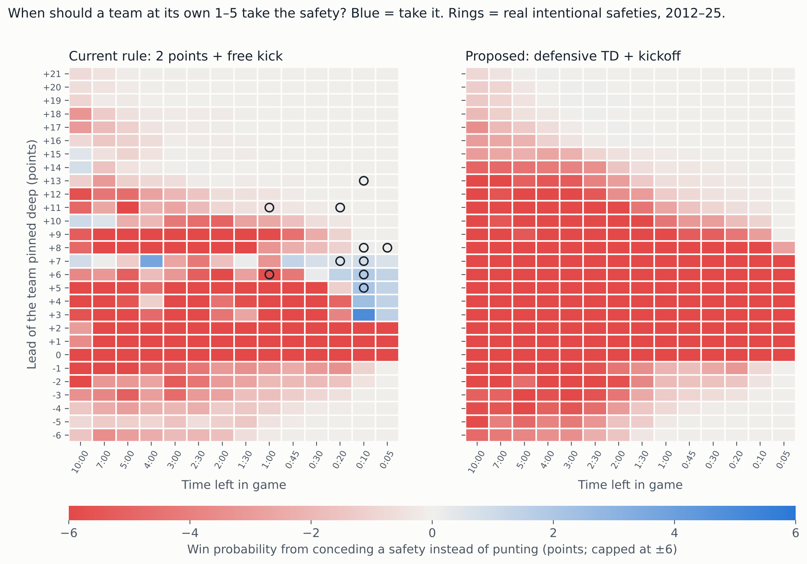

# The Defensive Touchdown Act: A Data-Driven Proposal to Revalue the Safety

> November 8, 2026 · Filed by the Ministry of Silly Plots, Office of Scoring Reform · File 2-PT/SAF

  <strong>SUMMARY</strong> 
  The safety is the only score in football in which the defense drives the offense backward through its own end zone. It is rewarded with two points, the smallest score on offer. Using 675,997 NFL plays from 2012 to 2025, the Ministry finds that (1) the safety is already worth about 3.9 points once the free kick is priced in, (2) three in four safeties are earned by a defense finishing off an offense pinned inside its own 10, and (3) the only deliberate use of the safety is a clock trick, in which a punter runs backward on purpose. The Ministry therefore proposes that a safety be scored as a <strong>defensive touchdown</strong>, followed by a normal kickoff. The amendment adds 1.6 points of value to every earned safety and abolishes the intentional safety outright.

**WHEREAS** a defense that sacks a quarterback at the opponent's 40-yard line receives a first-down's worth of congratulations, and a defense that sacks him in his own end zone receives two points, which is fewer than a field goal kicked by a man who has not been touched all afternoon;

**WHEREAS** the two points have not been revised in living memory, and no member of this Ministry can recall being consulted;

**WHEREAS** the rules currently permit a team protecting a lead to have its punter run 34 yards backward, out the rear of its own end zone, as a recognized form of strategy;

**NOW, THEREFORE,** the Ministry submits the following findings and proposed amendment.

## Finding 1: The safety is already undervalued on the scoreboard

Every score in football has two parts: the points, and what happens next. After a touchdown or field goal, the scoring team kicks off and the other team gets the ball. After a safety, the conceding team must free-kick from its own 20, and the *scoring* team gets the ball.

We priced the next possession for every restart since 2012 using expected points (EP) at the first snap of the following drive.

| Score (2024–25 rules) | On the scoreboard | Next possession | Net value |
|---|---|---|---|
| Touchdown | 6.96 | opponent receives kickoff (−1.41) | **5.54** |
| Field goal | 3 | opponent receives kickoff (−1.41) | **1.59** |
| Safety (current) | 2 | scorer receives free kick (+1.93) | **3.93** |
| Safety (proposed) | 6.96 | opponent receives kickoff (−1.41) | **5.54** |

Under current rules, a safety is worth more than two field goals combined, once each is netted against the possession that follows. The scoreboard says 2. Football says 3.9. The Ministry finds this to be a clerical error of long standing.

The gap is also widening. Each round of kickoff reform has handed the receiving team better field position, which makes a field goal worth less after the kickoff and makes the safety's free possession relatively more valuable.

| Era | Kickoff value to receiver | FG net | Safety net |
|---|---|---|---|
| 2012–15 | +0.75 | 2.25 | 3.75 |
| 2016–23 | +1.10 | 1.90 | 3.86 |
| 2024–25 | +1.41 | 1.59 | 3.93 |

## Finding 2: Safeties are earned

The Minister's position is that a defense which pushes an offense into its own end zone should be rewarded for doing so. The Ministry examined whether safeties are in fact earned or merely happen.

Of the 220 safeties since 2012 that were not conceded on purpose:

| How it happened | Safeties |
|---|---|
| Sack | 83 |
| Ball carrier stopped in the end zone | 66 |
| Offensive penalty in the end zone (mostly holding) | 25 |
| Intentional grounding under pressure | 22 |
| Blocked punt | 14 |
| Other | 10 |

The pass rush and run defense account for more than three quarters of them. A further finding complicates the heroic narrative slightly. **77% of safeties came on drives that started inside the offense's own 10**, and 40% came on the very first snap. Only 7% came on drives that began outside the 20. The defense usually finishes the job; a punter or a kickoff coverage unit usually starts it. The Ministry regards this as teamwork and declines to split the award.

## Finding 3: The only deliberate safety is a clock trick

We built a win-probability model from 2012–24 snaps (held-out 2025 Brier score 0.159, against nflverse's 0.171) and asked a simple question. When a team faces 4th down at its own 1–5 in the fourth quarter, when is it better to concede a safety than to punt?

Under current rules, almost never. Punting from the 1 or 2 is worth about 0.8 expected points more than conceding. The exception is a lead of 3 to 7 points with roughly ten seconds left (up to about thirty seconds when the lead is 6 or 7). There, conceding the safety runs out the clock, and the free kick from the 20 ends the game.

The league has discovered this independently. Since 2012 there have been 11 intentional end-of-game safeties, ringed on the left panel. All came from teams leading by 5 to 30 with 63 seconds or less to play. Several did not start anywhere near their own end zone: the punter took the snap and retreated 23, 28, and in one 2025 case 34 yards, spending the clock on the way.

The Ministry does not object to clock management. It objects to a rule under which running in the wrong direction is the correct play.

## The Proposed Amendment

> **Section 1.** A safety shall be scored as a touchdown for the defending team, worth six points.
>
> **Section 2.** The scoring team shall be entitled to a try, as after any touchdown.
>
> **Section 3.** Following the try, the scoring team shall kick off to the team that conceded the safety, under the kickoff rules then in force. The free kick from the 20-yard line is abolished.
>
> **Section 4.** Nothing in this amendment shall be construed as an endorsement of punters running backward.

## Impact Assessment

| | Current rule | Defensive Touchdown Act |
|---|---|---|
| Net value to the defense | 3.93 | 5.54 |
| Extra value per earned safety | — | +1.6 points |
| League-wide extra value per season | — | about 25 points |
| Punt advantage from own 1–2 | +0.83 EP | +2.54 EP |
| Punt advantage from own 6–10 | +1.42 EP | +3.13 EP |
| Game states where conceding helps | Lead 3–7, final ~10–30s | **None** (best case +0.1 WP pts) |
| Leading by 3–7, 10s left, conceding… | gains 1–5 WP pts | loses 43–92 WP pts |

The right panel of the decision map has no blue cells. The intentional safety ceases to exist as a strategy. It becomes harmless only once a team leads by 16 or more late, at which point it is also pointless.

**Retroactive review.** Applied to the scoreboard alone, the Act would have reversed 22 results since 2012 and sent another 8 games to overtime. Among the reversals is the 2022 Week 3 meeting between Buffalo and Miami, in which a Miami punt struck a teammate's posterior, went out of the end zone for a safety, and Buffalo lost 21–19. This is an upper bound: teams would have played those games differently, and the defense would have kicked off rather than received. The Ministry presents it as color, not as a claim on any standings.

## Objections Considered

**"It makes the goal line too important."** Correct, and measurable. If an offense is stopped at its own 1 rather than in its end zone, the defense is 1 to 3 points worse off under current rules and 3 to 5 points worse off under the Act. Spot-of-ball and forward-progress rulings would carry touchdown-sized stakes. The Ministry notes that the opposite goal line has carried such stakes since the invention of the goal line.

**"A sack is not a pick-six."** The Ministry agrees that they are different plays. It observes that both end with the defense in the end zone and the offense in disgrace.

**"The free kick is part of the safety's charm."** The free kick is currently the mechanism by which the safety is undervalued. The Ministry is unsentimental about it.

**"Sample sizes."** The free-kick value under 2024–25 rules rests on 21 kicks; the decision map rests on 449 real punts from a team's own 1–5 and 207 real post-safety free kicks. End-of-game kickoffs in the proposed-rule simulation are drawn from 714 real kickoffs by trailing teams in the final five minutes, about half of them onside attempts. Model noise is roughly ±3 win-probability points in individual cells away from the final seconds.

**"Expected points are not points."** Net value credits the scorer with the possession that follows. A strict reading of the scoreboard would disagree. This Ministry reads the whole game.

## Methods and Data

- **Data:** nflverse play-by-play, 2012–2025 regular and postseason, 675,997 plays in 3,829 games, deduplicated on game and play ID.
- **Restart value:** nflverse expected points at the first snap after each kickoff or free kick, excluding the final two minutes of each half. nflverse's own EPA scores a safety as a flat −2 and omits the free kick, so the free kick is priced separately.
- **Win probability:** gradient-boosted classifier with monotonic constraints (more points and better field position never hurt), trained on 2012–24, validated on 2025.
- **Decision map:** each option's outcomes are resampled from real plays and scored with the win-probability model. Assumes two timeouts each, an even point spread, and five extra seconds burned by a punter retreating through the end zone.
- **Code:** `posts/safety/analysis/safety_analysis.py`; all figures reproducible from `posts/safety/analysis/results.json`.

## Recommendation

The Ministry recommends that the Defensive Touchdown Act be adopted at the next available competition committee meeting, or, failing that, at the next available Thanksgiving dinner.

*Respectfully submitted,*
*The Office of Scoring Reform, Ministry of Silly Plots*
